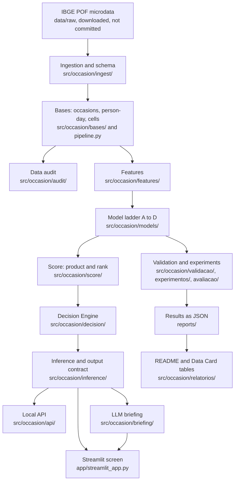

# Occasion Intelligence: pizza with guaraná soda

An end-to-end decision system built on public Brazilian survey microdata. It estimates in which contexts (weekday, time of day, place, state, audience) a person is most likely to have **pizza with guaraná-flavored soda**, ranks that context from 0 to 100 against a reference population, and turns the ranking into an activation recommendation chosen by explicit, documented rules. The question behind it: **in which contexts does guaraná beat cola, and which pizza contexts look like them?**

- **Data:** observed food intake from IBGE's Household Budget Survey (POF), editions 2008-2009 (training) and 2017-2018 (test). The target is what people reported eating, never a proxy.
- **Method:** a model ladder from a rate table to LightGBM, ten hypotheses pre-registered before any model ran, a recipe frozen by a git tag and a SHA-256 signature, and one temporal test on the later edition.
- **Headline result, reported as it came:** on 2017-2018 the frozen recipe did **not** rank contexts better than the product of the rate-table baselines (H8 refuted: PR-AUC gain -0.00003392, 95% CI [-0.0009391, 0.0007684]). The occasion part beat its table; the guaraná-preference part did not. [What that means](#what-the-negative-result-means).
- **Demo:** available after publication. Until then, the app runs locally from a clean clone in two commands ([Try it](#try-it)).

Stack: `Python 3.12` with `uv`, pandas, pandera, scikit-learn, LightGBM, Pydantic, Streamlit, Altair, FastAPI, httpx, pytest and Hypothesis.

This repository answers an open case brief written for a student AI league in partnership with Ambev ([`Occasion_Intelligence_Pizza_Guarana.md`](Occasion_Intelligence_Pizza_Guarana.md), in Portuguese). It is independent work on public data and is not endorsed by Ambev.

## Try it

**Online:** demo link available after publication.

**Locally, without the microdata** (the served model is committed in `models/servido/`):

```bash
git clone <this repository> && cd case-ambev
uv sync
make app        # Streamlit screen at http://localhost:8501
```

Fill in a context in the sidebar (state, urban or rural, weekday, time band, place, age, sex, income band, household size) and press the button. The screen, in Portuguese, shows:

- the **Occasion Score** (0 to 100), its class and the position of each of its two parts;
- the **top factors** behind it, with direction and the part each one comes from;
- the **recommendation** (objective and channel) and the rule that fired, in words;
- a **weekday x time band heat map** of the score with the other fields held fixed;
- an optional **LLM briefing**, with a line saying whether it came from the model or from the fixed fallback text;
- a **model panel** stating what the model was trained on and the H8 result.

The same prediction is available as a local API:

```bash
make api        # FastAPI on http://localhost:8000 (docs at /docs)
curl -s -X POST localhost:8000/predict -H 'Content-Type: application/json' \
  -d '{"uf":"SP","situacao":"urbano","dia_semana":"sabado","faixa_horario":"noite","local":"em_casa","idade":28,"sexo":"feminino","faixa_renda":"de_1_a_2_sm","numero_moradores":3}'
```

The response follows the output contract required by the brief: `occasion_score`, `classification`, `top_factors`, `recommendation_category`, `recommendation_reason` and `model_metadata`, plus `occasion_probability` and `score_components` (`src/occasion/inference/contract.py`).

## The question and why it is framed this way

Ambev already has sales data far richer than any public source, so a model that predicts *where pizza with soda already happens* would add little. The useful question for a flavor that competes with cola is narrower: **in which contexts does guaraná win the soda choice, and which pizza contexts look like those?**

The score therefore has two parts, multiplied together:

1. **Occasion** (the "when"): the probability of pizza and soda in the same hour, given the context. The unit is person x day x cell, where a cell is a time band crossed with a place (at home, away from home). Time and place only exist when someone eats; with one row per cell, whether or not anything was eaten in it, they become legitimate inputs instead of a leak of the outcome.
2. **Preference** (the "who and where"): the probability that the soda is guaraná-flavored, given the context. It is trained on **all** soda occasions, because pizza with guaraná soda alone is a rare event, with a `tem_pizza` ("has pizza") input that is observed in training and fixed to yes at inference.

Because the preference part is evaluated with pizza fixed to yes, the product is the chain rule for "pizza with guaraná soda in this cell", not an independence assumption. The product is shown as a weighted rank from 0 to 100 among the contexts of the reference population: raw cell probabilities are tiny and hard to read, and a rank is less sensitive to a change in overall frequency between editions.

The activation type is never a target. It is chosen downstream by the [Decision Engine](#decision-engine), from the two parts and the context.

## Architecture



- **One inference function.** The screen, the API and batch scoring all go through `prever` (`src/occasion/inference/predict.py`), which calls the same `pontuar` used in evaluation, so they cannot disagree. The screen only formats what `prever` returns.
- **Typed contract.** Input (`Contexto`) and output (`Resultado`) are Pydantic models; the API validates against them and returns 422 on invalid input (for example, age under 18 or an unknown state).
- **Signed core.** Everything that can change a number (configuration, ingestion, target definition, features, models, score, validation, evaluation and the test code itself) is listed in `ARQUIVOS_DA_RECEITA` (`src/occasion/bases/assinatura.py`) and covered by the recipe signature. The application layers (screen, API, briefing, Decision Engine, `predict.py`) sit outside it.
- **Gated target.** `carregar_base` (`src/occasion/bases/acesso.py`) is the only reader of the modelling bases for modelling and testing, and refuses the 2017-2018 target columns until the recipe tag exists.
- **Generated numbers.** The tables in this README and in the Data Card are written by `make docs` from `reports/*.json`. A test fails if they are stale, or if the prose quotes a decimal or percentage that is not in one of them.

## Data and target

The ground truth is the personal food intake block of the **Pesquisa de Orçamentos Familiares (POF)**, run by IBGE: each row is a food item eaten by a resident aged 10 or older on one of two recorded days, with the hour, the place and a calibrated survey weight. Microdata are public on IBGE's FTP server; `make dados-brutos` downloads them and records their checksums.

- **Occasion:** all items eaten by the same person, on the same day, in the same whole hour. "Pizza with soda" means both in the same occasion. The key is the same in both editions (decision R12).
- **Soda:** defined by product, generic or branded, with the same rule in both editions (decision R13). **Guaraná is always the soda flavor recorded by the survey**; the POF does not record the brand.
- **Targets:** `y_pizza_refri` (pizza and soda in the same hour within a cell) for the occasion part; `y_guarana` (the soda occasion includes guaraná soda) for the preference part; `y_pizza_guarana` (pizza and guaraná soda in the same hour within a cell) for the final score.
- **Inputs:** weekday, time band, place, state and region, urban or rural, age, sex, income per person in minimum wages (reais are not comparable across ten years) and household size. Every input is known when an activation is planned, before the occasion: that is the declared prediction instant ([leakage sheet](docs/ficha-de-vazamento.md), in Portuguese).
- **Weights:** `PESO_FINAL` in every population estimate and metric; whether it also helps in training was a hypothesis (H5).

The full description (sources and versions, variable dictionary, integration rules, leakage strategy, population, biases, license and LGPD) is in the **[Data Card](docs/DATA_CARD.md)**.

<!-- BEGIN:contagens -->
| Count | 2008-2009 | 2017-2018 |
|---|---|---|
| Person-days | 66,903 | 85,018 |
| Cells (person-day x time band x place) | 669,030 | 850,180 |
| Days with pizza and soda in the same hour | 651 | 796 |
| Days with pizza and guaraná soda in the same hour | 101 | 180 |
| Soda occasions | 19,182 | 16,112 |

| Person-days by weekday | 2008-2009 | 2017-2018 |
|---|---|---|
| Monday | 5,013 | 13,179 |
| Tuesday | 14,699 | 14,668 |
| Wednesday | 8,686 | 14,281 |
| Thursday | 17,383 | 14,799 |
| Friday | 10,314 | 7,644 |
| Saturday | 6,430 | 3,862 |
| Sunday | 4,378 | 16,585 |

Counts of the modelling bases (cells and soda occasions) after exclusions, unweighted. In 2017-2018 a few soda occasions are dropped for undetermined place, so the totals differ slightly from the parser reference table. Days with pizza and no soda are not listed: counting them would require reading the 2017-2018 person-day base outside the gated loader.
<!-- END:contagens -->

## Method

Each choice below is the one fixed before the corresponding experiment ran. The literature behind them is listed, with checked links, in [`docs/REFERENCES.md`](docs/REFERENCES.md).

- **Declared prediction instant and per-variable leakage check.** Every input is justified against the moment of planning ([leakage sheet](docs/ficha-de-vazamento.md)); a shuffled-label run (`make embaralhado`) is a sanity check against leakage. Following [Kapoor and Narayanan (2023)](https://doi.org/10.1016/j.patter.2023.100804).
- **Temporal split, test opened once.** Everything fitted or chosen (EDA, time bands, variables, ladder, hyperparameters, calibration, cutoffs) used 2008-2009 only. The 2017-2018 target was read once, after the freeze, so the test measures the chosen model instead of taking part in choosing it. Before that, the edition was used only without its target (parser counts, schema harmonization, an adversarial check on input columns), and a few raw counts and guaraná/cola shares had been seen before the design was written; the [Data Card](docs/DATA_CARD.md#5-leakage-strategy) lists exactly what ([Hastie, Tibshirani and Friedman, 2009, ch. 7](https://doi.org/10.1007/978-0-387-84858-7); [Cawley and Talbot, 2010](https://jmlr.org/papers/v11/cawley10a.html)).
- **Pre-registration.** Ten hypotheses, their metrics and decision rules were committed in [`docs/pre-registro.md`](docs/pre-registro.md) before the stage that tests each one; every experiment writes a JSON, failed ones included ([Lones, 2024](https://doi.org/10.1016/j.patter.2024.101046)).
- **Validation that follows the survey design.** Nested cross-validation inside 2008-2009, 5 outer and 3 inner folds, keeping each sampling sector (`cod_upa`) whole and spreading sectors within strata, so no person, household or sector is on both sides ([Wieczorek, Guerin and McMahon, 2022](https://doi.org/10.1002/sta4.454)).
- **Uncertainty by sector bootstrap.** Every interval comes from a paired bootstrap of whole sectors within each state (1000 replicates, percentile 95% interval). Sectors, not rows, because rows in a sector are not independent; within the state rather than the stratum, because many strata have only a handful of sectors.
- **Metrics fixed in advance.** Weighted log loss chooses models, because the probability becomes the score. PR-AUC is the headline for the final test because the event is rare and the question is whether the most likely contexts come first. ROC-AUC, Brier and calibration at three levels (mean, slope, curve) are reported alongside ([Van Calster et al., 2019](https://doi.org/10.1186/s12916-019-1466-7)).
- **A ladder with a strong baseline.** A: weighted rate table (no ML). B: regularized logistic regression. C: logistic with splines for age and income and pre-declared interactions. D: LightGBM with shallow trees. A step only takes over if the interval of its gain excludes zero against the current champion; ties go to the simpler model. The baseline is not a straw man: step A's dimensions and smoothing are tuned in the inner folds like any other hyperparameter. A regularized logistic model is treated as a serious contender to the tree model ([Christodoulou et al., 2019](https://doi.org/10.1016/j.jclinepi.2019.02.004)).
- **Events, not rows, bound complexity.** Model size is checked against sample-size criteria computed on events ([Riley et al., 2019](https://doi.org/10.1002/sim.7992); [Riley et al., 2020](https://doi.org/10.1136/bmj.m441); [van der Ploeg, Austin and Steyerberg, 2014](https://doi.org/10.1186/1471-2288-14-137)). That is why the score is split in two parts, each with many more events than the joint outcome.
- **No resampling of the rare event.** Class rebalancing distorts probabilities, and the score depends on them ([van den Goorbergh et al., 2022](https://doi.org/10.1093/jamia/ocac093)). For the same reason, synthetic data were not used to enlarge the sample.
- **Frozen recipe.** The recipe (variables, time bands, weighting, winning step per part with its hyperparameters, calibration, score formula and cutoffs) is frozen by the git tag `receita-congelada` and a SHA-256 signature over the signed files. `make avaliado` and `make teste-final` refuse to run if the signature differs from the tag's, and the final test checks the installed versions of numpy, pandas, scipy, scikit-learn, LightGBM and pyarrow against a signed file. Decisions and rejected alternatives are logged in [`docs/registro-de-decisoes.md`](docs/registro-de-decisoes.md).
- **Evaluated model, then served model.** What is validated is the recipe. After the test result was committed, the same recipe was refitted on both editions for the application (H9 found no evidence that adding 2008-2009 hurts prediction of 2017-2018), as recommended for prediction models ([Steyerberg and Harrell, 2016](https://doi.org/10.1016/j.jclinepi.2015.04.005)). The served model has no temporal test of its own; the metrics shown are the recipe's. Reporting follows the structure of [TRIPOD+AI](https://doi.org/10.1136/bmj-2023-078378) as a reference, not as a checklist.
- **Exploratory learning curve.** Would LightGBM win with more data? Steps C and D were refit on growing fractions of the training sectors and projected to twice the sample with a straight line in log(n) ([Perlich, Provost and Simonoff, 2003](https://www.jmlr.org/papers/v4/perlich03a.html); [Figueroa et al., 2012](https://doi.org/10.1186/1472-6947-12-8)). By a rule declared before running it, the projection does not change the served model; it motivates comparing C and D on the next POF edition (`reports/experimentos/curva_aprendizado.json`).

## Results

Ten pre-registered hypotheses. "Gain" is the reference's loss minus the candidate's (positive favors the candidate). A hypothesis is supported only if the 95% interval excludes zero in its favor; H5, H6 and H9 have a default option, and a result without evidence against the default keeps it. Source: `reports/hipoteses.json`.

<!-- BEGIN:hipoteses -->
| ID | Part | Quantity | Estimate [95% CI] | Verdict |
|---|---|---|---|---|
| H1 | occasion | log-loss gain of logistic (B) over rate table (A) | 0.0005431 [0.0003421, 0.0007538] | supported |
| H1 | preference | log-loss gain of logistic (B) over rate table (A) | 0.004924 [0.0004795, 0.009413] | supported |
| H2 | occasion | log-loss gain of curves and interactions (C) over logistic (B) | 0.00005515 [0.000008558, 0.0001018] | supported |
| H2 | preference | log-loss gain of curves and interactions (C) over logistic (B) | 0.002859 [0.0004035, 0.005265] | supported |
| H3 | occasion | log-loss gain of LightGBM (D) over best logistic | 0.00002391 [-0.00006402, 0.0001138] | refuted |
| H3 | preference | log-loss gain of LightGBM (D) over best logistic | -0.003015 [-0.006464, 0.0006158] | refuted |
| H4 | preference | pizza coefficient, log-odds | -0.3441 [-0.6212, -0.05415] | supported |
| H5 | occasion | log-loss gain of unweighted over weighted training | -0.00002390 [-0.0001291, 0.00008281] | no evidence against the default |
| H5 | preference | log-loss gain of unweighted over weighted training | 0.002408 [-0.0002882, 0.005259] | no evidence against the default |
| H6 | - | log-loss gain of direct model over product | -0.00006572 [-0.0001361, -0.00001569] | no evidence against the default |
| H7 | - | log-loss gain of corrected over raw product | -0.000005365 [-0.00001630, 0.000003415] | refuted |
| H8 | - | PR-AUC gain of recipe over rate-table product, 2017-2018 | -0.00003392 [-0.0009391, 0.0007684] | refuted |
| H9 | occasion | log-loss gain of recent-only over combined training | 0.00002312 [-0.00005178, 0.00009611] | no evidence against the default |
| H9 | preference | log-loss gain of recent-only over combined training | -0.0002741 [-0.004465, 0.003926] | no evidence against the default |
| H9 | preference (pizza only) | log-loss gain of recent-only over combined training | 0.01037 [-0.02056, 0.04505] | no evidence against the default |
| H10 | - | rank correlation, search interest vs. POF share | - | not run |
<!-- END:hipoteses -->

How to read the rows that are easy to misread:

- **H3 refuted:** LightGBM did not beat the best logistic model in either part, so the recipe is step C (logistic with curves and interactions) in both.
- **H4:** given the same context, soda occasions with pizza have lower odds of being guaraná. This is an association, not an effect of pizza on the choice.
- **H6:** the interval excludes zero, but the gain is negative: the model trained directly on pizza with guaraná soda predicted *worse* than the product of the two parts, so the default (the product) stays.
- **H7 refuted:** a sigmoid correction of the product did not improve its log loss, so it did not enter the recipe. It does not mean the product is miscalibrated; the calibration slope in `reports/hipoteses.json` shows no miscalibration.
- **H10 not run:** the Google Trends block was cut before any comparison with the POF (state shares come rounded to whole percentages, the topics mix unrelated searches, and most states have no value in 2008-2009). Search interest is never used as consumption or as a target; the exported files stay in `dados_externos/google_trends/` as a record.

**Final temporal test (H8),** recipe trained on 2008-2009 and scored once on 2017-2018 (`reports/teste_final.json`):

<!-- BEGIN:teste_final -->
| Target | PR-AUC recipe | PR-AUC reference | Gain [95% CI] | Verdict | Reference |
|---|---|---|---|---|---|
| H8: score (guaraná soda with pizza) | 0.001877 | 0.001911 | -0.00003392 [-0.0009391, 0.0007684] | refuted | product of step-A rate tables |
| occasion | 0.01304 | 0.008841 | 0.004199 [0.002116, 0.008206] | supported | step-A rate table |
| preference (all soda occasions) | 0.3187 | 0.3067 | 0.01208 [-0.004224, 0.02856] | refuted | step-A rate table |
| preference (pizza only) | 0.2398 | 0.2329 | 0.006865 [-0.05160, 0.05794] | refuted | step-A rate table |

A part is 'supported' only if the 95% interval of the PR-AUC gain excludes zero in favor of the recipe; otherwise it is 'refuted'. Evaluated on 2017-2018 cells, weighted.
<!-- END:teste_final -->

**Segments of the final test.** In every segment the observed / expected ratio is above 1: the event is more frequent in 2017-2018 than the 2008-2009 recipe expects. The shift is not uniform: 1.948 at home against 1.106 away from home, 1.958 in the Southeast against 1.203 in the South. Under-prediction that varies by segment does change the ranking across segments, so it is part of why the score lost ground over time.

<!-- BEGIN:segmentos_teste -->
| Dimension | Level | Cells | Positives | PR-AUC | Observed / expected |
|---|---|---|---|---|---|
| region | Center-West | 103,800 | 25 | 0.002369 | 1.361 |
| region | North | 128,070 | 20 | 0.001519 | 1.672 |
| region | Northeast | 296,900 | 66 | 0.002663 | 1.659 |
| region | South | 110,530 | 27 | 0.003253 | 1.203 |
| region | Southeast | 210,880 | 42 | 0.001737 | 1.958 |
| place | at home | 425,090 | 122 | 0.002428 | 1.948 |
| place | away from home | 425,090 | 58 | 0.0009988 | 1.106 |
| sex | female | 455,890 | 100 | 0.002268 | 1.572 |
| sex | male | 394,290 | 80 | 0.001605 | 1.733 |

Score of the recipe on 2017-2018, weighted; observed / expected is the ratio of mean outcome to mean score.
<!-- END:segmentos_teste -->

**Out-of-fold metrics of the recipe on 2008-2009** (development reference, `reports/avaliacao_2008.json`):

<!-- BEGIN:metricas_2008 -->
| Model | Rows | Positives | Prevalence | PR-AUC | ROC-AUC | Log loss | Brier |
|---|---|---|---|---|---|---|---|
| Occasion (cells) | 669,030 | 654 | 0.001303 | 0.02377 | 0.9177 | 0.007770 | 0.001285 |
| Preference (all soda occasions) | 19,182 | 4,684 | 0.2345 | 0.3189 | 0.6084 | 0.5310 | 0.1746 |
| Preference (pizza only) | 655 | 101 | 0.1392 | 0.1644 | 0.5269 | 0.4134 | 0.1226 |
| Score (product) | 669,030 | 101 | 0.0001815 | 0.002627 | 0.9145 | 0.001462 | 0.0001813 |

Out-of-fold predictions on 2008-2009; prevalence, metrics and the score are weighted by the survey weight, rows and positives are unweighted.
<!-- END:metricas_2008 -->

## What the negative result means

H8 is the project's main claim about generalization over time, and it was refuted. That is reported here as a result of the method working, not hidden as a failure.

**It was a fair test, run once.** The hypothesis, metric, reference and decision rule were committed before any model ran. The recipe was frozen by tag and signature, and the 2017-2018 target sat behind a gated loader until then. The 2017-2018 target was opened once, on 21 November 2026 (what had been seen of that edition before is listed in the [Data Card](docs/DATA_CARD.md#5-leakage-strategy)), and the test JSON was committed as it came; a later re-execution from the raw files reproduced the same metrics. The reference was made strong on purpose (step A tuned by nested cross-validation), which makes the test harder to pass, not easier.

**What the numbers say.** The score reached a PR-AUC of 0.001877, against 0.001911 for the product of the step-A tables: a gain of -0.00003392, 95% CI [-0.0009391, 0.0007684]. The interval is wide. It does not show that the recipe is worse, and it does not prove the two are equivalent. It shows that, on this test, the recipe adds nothing demonstrable over counting.

**Where the limit is.** The two parts behave differently:

- **The occasion part generalizes.** On 2017-2018 it beats its table, with a gain of 0.004199 [0.002116, 0.008206]: the model ranks *when* pizza with soda happens better than counting does, ten years later.
- **The preference part does not.** In all soda occasions the gain is 0.01208 [-0.004224, 0.02856], and in occasions with pizza it is 0.006865 [-0.05160, 0.05794]. This weakness was declared before the test: at recipe approval, the preference model already ranked weakly out of fold (ROC-AUC 0.6084 in all soda occasions and 0.5269 in the pizza slice, with 101 positive cases), and the decision log recorded as a risk the premise that preference learned from all meals carries over to meals with pizza. H8 tested that premise, and the product did not beat the tables.

**Ten years and a change of method.** 2008-2009 used a food record filled in by the resident; 2017-2018 used a 24-hour recall interview. Any drop between editions mixes a decade of habit change with the change of collection method, and this project cannot separate them. The post-test diagnosis (`make pos-teste`, `reports/pos_teste.json`) refits the same recipe by cross-validation inside 2017-2018 to show how much is lost in crossing the decade; it changes no reported number.

**What changed because of it: nothing in the recipe.** Changing the model after seeing the test would turn the test into part of the selection. The limitation is shown in the app's model panel and here. For a reader of the app, the practical consequence is that the occasion position carries the signal that held up over time, while the guaraná-preference position is weak evidence, and the objective that depends on it should be read that way.

## Decision Engine

Explicit rules over the two positions of the score and the context (`src/occasion/decision/engine.py`). There is no model in this layer.

**Layer 1, objective,** from the two parts of the score:

| | Preference high (position ≥ 50) | Preference low (< 50) |
|---|---|---|
| **Occasion high (position ≥ 75)** | Sustain (`Sustentar`): keep presence where it already works | Convert (`Converter`): the occasion exists and guaraná lags |
| **Occasion low (< 75)** | Create the occasion (`Criar ocasião`): guaraná is preferred and pizza is missing | Do not prioritize (`Não priorizar`) |

"Preference high" means guaraná is more likely than in the median context of the reference population, **not** that guaraná beats cola: in absolute terms cola leads in most contexts.

**Layer 2, channel,** ordered rules where the first match wins:

| Order | Condition | Main channel |
|---|---|---|
| 1 | Objective is "do not prioritize" | None |
| 2 | Objective is "convert" and age under 30 | Influencers and digital content |
| 3 | Away from home | In-pizzeria activation |
| 4 | At home, urban | Combo in a delivery app |
| 5 | At home, rural | Pizza and guaraná together at retail |

A complementary channel, **regional media**, is added when the state is among the 7 with the highest mean guaraná preference in the reference population (ties included).

- **Rule 5 is a business assumption, not a POF result:** it assumes delivery apps have lower coverage in rural areas. The POF has no channel; place (at home or away) is the only proxy.
- **Cutoffs.** 75 and 50 for the objective, and 80 and 50 for the score class (`alta`, `média`, `baixa`), were fixed in the design and kept at recipe approval. There are no cost figures for false positives and negatives, so no cutoff is "optimal"; `reports/experimentos/cortes.json` reports precision and recall at the class cutoff and how many cells change quadrant if each Decision Engine cutoff moves 10 points.
- **Output.** `recommendation_category` is objective plus channel (for example `Converter, via combo em app de delivery`). `recommendation_reason` is built from a fixed template: the objective, the rule that fired in words, the channels, up to three factors and a closing sentence stating that the recommendation says the activation fits the context and does not estimate its effect.
- **Adults only.** The application accepts ages 18 and over, although the model is trained on everyone aged 10 or older.

## Explainability and LLM briefing

**Factors.** For the logistic recipe, each variable's contribution is `coef · (x − weighted training mean)` over its columns, in log-odds relative to the average training context; an interaction is split half and half between its two variables, and the contributions plus the intercept add up exactly to the logit of the prediction. For LightGBM (step D, evaluated but not served) contributions come from LightGBM's own TreeSHAP (`pred_contrib`), on the same scale. `top_factors` lists the five largest absolute contributions across both parts, each with its part, variable, value, direction and size; `tem_pizza` is never a factor, because it is fixed by the question. Global importance and the stability of each factor across folds (flagged unstable when its sign flips between folds above a threshold, `LIMITE_INSTAVEL`) are in `reports/avaliacao_2008.json`. Contributions describe what the model does, not causal effects.

**Briefing.** An optional button turns the structured decision into a short text in Portuguese for a marketing reader (`src/occasion/briefing/`). It is built to fail safe:

- **Input:** only the context the user typed and the model's output (score, positions, probabilities, factors, recommendation and the flavor-not-brand notice). No microdata leaves the machine.
- **Provider:** any OpenAI-compatible `chat/completions` endpoint, configured through `BRIEFING_BASE_URL`, `BRIEFING_MODELO` and `BRIEFING_CHAVE` (environment variables or Streamlit secrets; see `.env.example`). No key is committed.
- **Prompt rules:** use only the factors, numbers and category received, with the direction received; no claim of effect on sales; guaraná is a flavor; no brands.
- **Automatic check of every answer:** each number in the text must exist in the input, accepting equivalent forms (comma or point, fraction or percentage, rounding to the decimals shown); the text must not contain forbidden terms (effect claims such as "vende mais", "causa", "garante", "impacto", and brand names).
- **Fallback:** a fixed-template text built from the same output replaces the model's text when there is no key, the provider fails or times out (15 s), the quota is exhausted, the answer is malformed, the check fails or the session limit is reached. The screen always says which text it shows and why.
- **Cost guards for a public demo:** a cache keyed by the SHA-256 of the input (only approved texts are cached) and a limit of 5 provider calls per session.
- **Declared limit of the check:** it does not verify automatically that each factor *named* in the text is in `top_factors`. Matching variable identifiers almost never catches anything, and matching the Portuguese labels would reject faithful texts, because the context uses the same words. The guarantee on factors comes from the prompt and the number check.

## Limitations

- **Flavor, not brand.** Every statement is about guaraná-flavored soda as recorded by the survey.
- **Associations only.** The data are observational. Nothing here supports a claim that an activation causes consumption, or that one activation sells more than another.
- **The preference part ranks weakly,** especially in the pizza slice, and the score did not beat the rate tables over time ([above](#what-the-negative-result-means)).
- **Old data, before the delivery boom.** The latest edition is 2017-2018; nothing here describes current consumption or app ordering.
- **No channel, no calendar date.** The POF records only at home or away, and only the weekday of consumption. Weather, holidays and seasonality are out of the score: the calendar date can be rebuilt in 2008-2009 but not in 2017-2018 (section 26 of the decision log).
- **Different measurement between editions:** food record versus 24-hour recall, "place" meaning the food's source in 2008-2009 and where it was eaten in 2017-2018, and a weekday mix driven by collection design (see the counts above).
- **Self-reported intake,** with the under-reporting risk of any dietary survey.
- **The served model is never tested on its own;** no clean data is left to test it.
- **Choices that looked at the 2008-2009 target:** the weekend interaction set and step A's alternatives were drafted after the EDA. They are tuned in inner folds, which mitigates but does not remove the bias; its direction is declared in the pre-registration (conservative for H8, possibly optimistic for H2).
- **Rule-based channels and cutoffs** encode assumptions, not measured costs.
- **Adult-only application on a model trained from age 10.**

## Reproduce everything

**Path 1, the app from a clean clone** (no microdata needed; the served model is committed):

```bash
uv sync            # Python 3.12 and locked dependencies
make app           # Streamlit screen
make api           # optional: local FastAPI
make teste         # tests that do not need the microdata
```

To enable the LLM briefing, export the three `BRIEFING_*` variables listed in `.env.example` or put them in `.streamlit/secrets.toml`. Without them the screen shows the fallback text with the reason "sem chave configurada".

**Path 2, everything from the IBGE microdata to the final test,** in order (run from the repository root):

```bash
make ambiente           # uv sync
make tudo               # dados-brutos, bases, auditoria, baseline: about 34 s once the zips are downloaded
make teste-dados        # all tests, including the parser reference counts
make eda                # executes notebooks/eda_2008.ipynb (2008-2009 only); minutes
make experimentos       # 2008-2009 chain: dobras peso escada h4 embaralhado calibracao produto cortes receita avaliacao-2008
                        # hours: the escada's LightGBM alone takes about 90 min; the rest, minutes
make avaliado           # evaluated model in models/avaliado/; requires a clean tree on the signed files
make teste-final        # H8 on 2017-2018 (needs the tag); a re-run writes teste_final_reexecucao.json instead of overwriting
make pos-teste          # post-test diagnosis and H9
make servido            # served model in models/servido/ (only with teste_final.json committed)
make curva-aprendizado  # exploratory learning curve
make hipoteses          # reports/hipoteses.json, H1 to H10
make contagens          # reports/contagens.json (reference counts); reads the 2017-2018 target, so only after the test is committed
make docs               # regenerate the tables of this README and the Data Card
make qualidade          # ruff and pyright
```

- `make dados-brutos` (inside `make tudo`) verifies checksums and does not download again what is already there. `make investigacao-datas` rebuilds the calendar-date investigation.
- The chain rewrites `reports/`, so JSON written after the first step carry a `-dirty` commit. Compare numbers ignoring `data_hora`, `commit` and timings.
- Run the long chain plugged in with the lid open; a sleeping machine interrupts it.

## Repository map

| Path | What it holds | Brief deliverable |
|---|---|---|
| `src/occasion/ingest/`, `bases/`, `pipeline.py` | Download, fixed-width parsers, pandera schema, occasion, person-day and cell bases | Dataset and reproducible pipeline |
| `docs/DATA_CARD.md` | Data Card | Data Card |
| `notebooks/eda_2008.ipynb`, `src/occasion/eda/`, `src/occasion/features/` | EDA (2008-2009 only) and features | EDA and feature engineering |
| `src/occasion/models/`, `score/` | Rate table, logistic, LightGBM; score as product and rank | Baseline, higher-capacity model, Occasion Score |
| `src/occasion/validacao/`, `experimentos/`, `avaliacao/` | Folds, sector bootstrap, metrics, hypotheses, final test, segments, errors, explainability | Evaluation |
| `src/occasion/decision/` | Decision Engine rules | Decision Engine |
| `src/occasion/inference/`, `app/`, `src/occasion/api/` | Inference function and contract, Streamlit screen, local API | Functional application |
| `src/occasion/briefing/` | LLM briefing with check, fallback, cache and session limit | Optional generative layer |
| `src/occasion/audit/` | Availability, sample size and adversarial check of the editions | Data audit |
| `src/occasion/relatorios/` | Reference counts and the generated tables of the docs | Documentation |
| `reports/`, `reports/experimentos/` | Every result as JSON, committed | Evaluation |
| `models/servido/` | Served model artifact, committed | Application |
| `tests/` | pytest and Hypothesis; tests marked `dados` need the microdata | |
| `docs/pre-registro.md`, `docs/registro-de-decisoes.md`, `docs/ficha-de-vazamento.md` | Pre-registration, decision log, leakage sheet (Portuguese) | Method record |
| `docs/superpowers/` | Design documents and implementation plans (Portuguese) | Process record |
| `docs/REFERENCES.md` | Checked literature | |
| `dados_externos/google_trends/` | Exported Trends files kept as a record of the cut block | |

## Next steps

- **POF 2024-2025 as a second test** when its microdata are published: a clean test for the served model, and the place to compare steps C and D that 2017-2018 could no longer judge.
- **"Mesa":** household members eating pizza in the same hour, as a shared-meal signal.
- **A collector of delivery menus,** to bring a channel the POF lacks, kept separate from the survey's observations.
- **Weather in state capitals for 2008-2009,** where the calendar date can be rebuilt.
- **Translation** of the screen and of the Portuguese documents.

## How this was built

Built with Claude Code under the process documented in `docs/` (design, pre-registration, plans, review and decision log), with every decision made by the author.

## A note on language

The code identifiers, the screen and part of the documents are in Portuguese. Identifiers in signed files are not translated, so as not to break the recipe signature that protects the final test.

## License

The code is released under the [MIT License](LICENSE). The IBGE microdata are not redistributed here: `make dados-brutos` downloads them from IBGE, and their use follows IBGE's terms. The case brief (`Occasion_Intelligence_Pizza_Guarana.md`) is included for context and is not covered by the MIT License.
